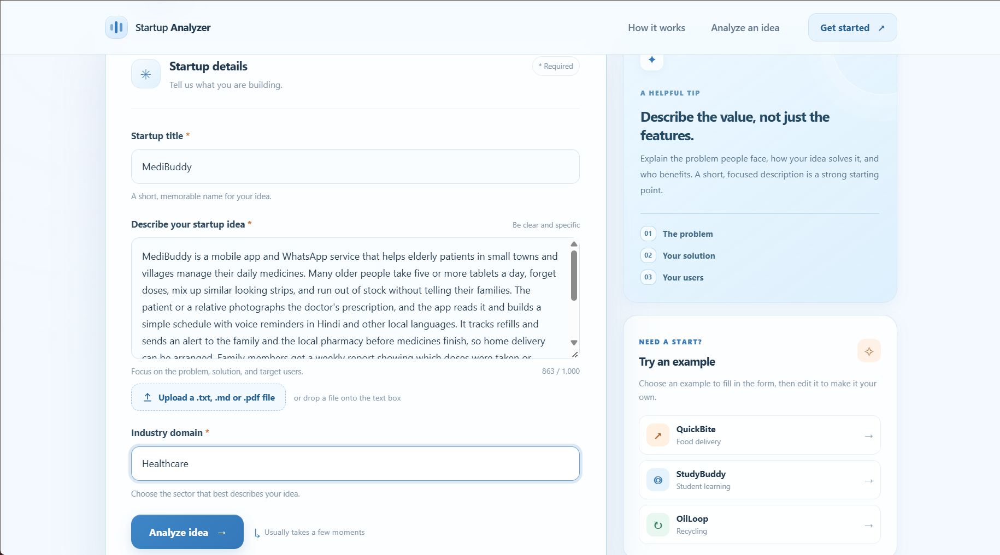
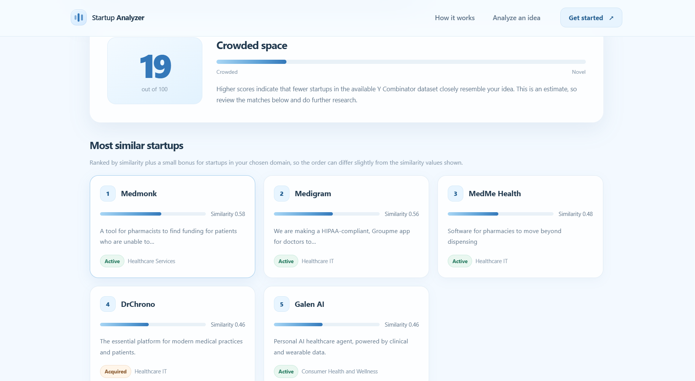
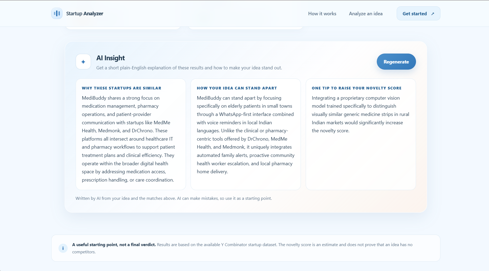

# AI Startup Idea Similarity Checker

> "Has someone already built this?" Paste a startup idea and find out in seconds.

A final-year B.Tech project that compares a startup idea against **5,625 Y Combinator startups** by *meaning* (not keywords). It returns a **novelty score out of 100**, the **5 closest startups**, and an **AI-written explanation** of why they are similar and how your idea can stand apart.



## Features

- **Semantic search.** Ideas are compared by meaning using sentence embeddings, so "meal delivery for students" matches "food ordering for campuses" even with no shared words.
- **Novelty score (0 to 100)** with a plain label: *Crowded space*, *Some competition* or *Fairly novel*.
- **Top 5 similar startups** with similarity, industry and status (active, inactive, acquired).
- **AI Insight.** An LLM explains the overlap, suggests how to differentiate, and gives one tip to raise the score. It only explains the retrieved matches, so it cannot invent startups. If the AI service is unavailable, it tries backup models and then falls back to a clearly labelled rule-based summary.
- **Upload an idea.** Load the description from a `.txt`, `.md` or `.pdf` file (read in the browser) or drag a file onto the text box.
- **Input checks.** The server rejects gibberish and keyboard-mashing using the corpus itself as a dictionary.
- **Responsive, light "liquid glass" UI** built with plain HTML, CSS and JavaScript.



## How it works

```
Your idea ──► embedding (384 numbers) ──► cosine similarity vs 5,625 startups
                                                  │
                         ┌────────────────────────┴───────────────────┐
                         ▼                                            ▼
              top-3 average → novelty score              top-5 matches (with domain boost)
                                                                      │
                                                                      ▼
                                              LLM explains the matches (AI Insight)
```

1. **Embed.** The description is turned into a 384-dimension vector with `all-MiniLM-L6-v2`, running locally in Node.js through Transformers.js.
2. **Compare.** The vector is compared with the pre-computed vector of every startup using cosine similarity.
3. **Score.** The average similarity of the top 3 matches is mapped to a novelty score: an average of 0.60 (about a near-copy) gives 0, and 0.30 (about unrelated text) gives 100.
4. **Rank.** Results are ordered by similarity plus a small bonus (+0.08) for startups in the domain you chose. The bonus only affects the order, never the novelty score or the similarity shown.
5. **Explain.** The idea and the top matches are sent to an LLM (Google Gemini by default) which writes the three short insight paragraphs.

> **Why similarity is a decimal and novelty is out of 100.** Similarity is the raw cosine value between two vectors. In this model unrelated text already scores about 0.30 and a near-copy about 0.60, so a value like 0.56 is *very close*, not "56% similar". The novelty score rescales that range to something easier to read.

## Example results

| Idea | Domain | Novelty | Closest match |
|---|---|---|---|
| Medicine-reminder app for elderly patients | Healthcare | 19, Crowded space | Medmonk (0.58) |
| Job-readiness platform for engineering students | Education | 24, Crowded space | Skill-lync (0.54) |
| Repair marketplace for retired craftsmen | Environment | 57, Some competition | Jeevy Fabrication (0.45) |

The full text of these three ideas and screenshots of every run are in the [`sample-docs`](sample-docs) folder.



## Tech stack

| Layer | Technology |
|---|---|
| Server | Node.js, Express |
| Embeddings | `all-MiniLM-L6-v2` via [Transformers.js](https://github.com/xenova/transformers.js) (runs locally, no API) |
| Similarity | Cosine similarity (dot product of normalised vectors) |
| AI Insight | Google Gemini by default; Anthropic and OpenAI are also supported |
| PDF reading | [pdf.js](https://github.com/mozilla/pdf.js) (bundled in `public/vendor/pdfjs`) |
| Frontend | HTML, CSS, vanilla JavaScript |

## Project structure

```
├── server.js              Express server, /api/analyze (matching and novelty score)
├── server/
│   ├── insight.js         /api/insight (AI Insight, provider calls, fallback)
│   └── scripts/           buildCorpus.js, validateCorpus.js, foodDeliveryTest.js
├── public/
│   ├── index.html
│   ├── script.js
│   ├── style.css
│   └── vendor/pdfjs/      pdf.js (Apache-2.0, own LICENSE included)
├── sample-docs/           3 sample ideas (.txt) and screenshots of their results
├── .env.example           template for your API key (never commit the real .env)
└── LICENSE.md
```

The startup dataset (`server/data/raw/`), the pre-computed embeddings (`server/data/corpus/`) and the downloaded model files (`server/data/.model-cache/`) are **not included** in this repository. See below to rebuild them.

## How to run this project

You need **Node.js 18 or newer** (download it from nodejs.org). Everything below is typed in a terminal (Command Prompt, PowerShell or Terminal) inside the project folder.

### Step 1. Get the code

Either clone it with Git:

```bash
git clone <repo-url>
cd <repo-folder>
```

or click the green **Code** button on this page, choose **Download ZIP**, unzip it and open a terminal in the unzipped folder. (`<repo-url>` is the address you copy from the green **Code** button.)

### Step 2. Install the packages

```bash
npm install
```

### Step 3. Add the dataset and build the search index (one time)

The startup dataset is not stored in this repository. Create the folders `server/data/raw/` and place two CSV files in it:

- `yc_startups_dataset.csv`
- `Tech_Companies_10k.csv`

Then run:

```bash
npm run build:corpus     # cleans and merges the data, then creates the embeddings (downloads the model on first run, so it needs internet)
npm run validate         # checks the output against the expected counts
npm run test:search      # sanity check: "app for ordering food delivery" must return food startups
```

`validate` is written for the exact dataset used in this project (5,785 raw rows, 5,625 after cleaning), so it will report failures on a different dataset.

### Step 4. (Optional) turn on AI Insight

AI Insight needs a free API key, for example from Google AI Studio (Gemini). Copy the file `.env.example` and rename the copy to `.env`, then add your key after the equals sign:

```
GEMINI_API_KEY=your_key_here
```

Anthropic (`ANTHROPIC_API_KEY`) and OpenAI (`OPENAI_API_KEY`) keys also work. If more than one key is present, the others are used as a backup when the first provider is busy. Optional settings in `.env`:

| Setting | Purpose |
|---|---|
| `INSIGHT_PROVIDER` | Force one provider: `gemini`, `anthropic` or `openai` |
| `INSIGHT_MODEL` | Choose the main model |
| `INSIGHT_FALLBACK_MODELS` | Comma-separated backup models |

Without a key the project still works, and AI Insight shows a clearly labelled rule-based summary instead.

### Step 5. Start the server

```bash
node server.js
```

Wait until the terminal prints `Server running on ...`. Copy that address into your web browser to open the app. (Loading the corpus and the model takes a few seconds the first time.)

### Step 6. Use it

1. Type a **startup title** and describe your idea in 40 to 1,000 characters (or upload a `.txt`, `.md` or `.pdf` file, or click an example). You can also use one of the ideas in [`sample-docs`](sample-docs).
2. Pick the closest **industry domain**.
3. Click **Analyze idea** to see your novelty score and the 5 closest startups.
4. Click **Generate AI insight** for a written explanation and tips.

To stop the server, press `Ctrl + C` in the terminal.

### Troubleshooting

| Problem | Fix |
|---|---|
| The server fails to start while loading the corpus | Step 3 was probably not completed. Add the two CSV files and run `npm run build:corpus`. |
| `Cannot find module` | Run `npm install` in the project folder. |
| The page says the server is not running | Start it with `node server.js` and keep the terminal open. |
| The address is already in use | Another program is using the port. Close the other copy of the server and start again. |
| AI Insight shows a "rule-based summary" | No valid API key was found in `.env`, or the AI service was busy. Check the key, save the file, restart the server and click **Regenerate**. The terminal shows the reason. |

## Security notes

- The API key lives only in the server's `.env` file and is never sent to the browser.
- All text from the user or the AI is inserted into the page with `textContent`, never as HTML.
- The server validates input again and limits `/api/insight` to 12 requests per minute.
- Uploaded files are read in the browser; nothing is stored.

## Limitations

- The novelty score is an **estimate**. It only knows about the startups in the dataset and does not prove that an idea has no competitors.
- English descriptions only.
- The browser only sees the 5 returned matches, and the domain bonus can in rare cases push a closer startup out of the top 5.
- Scanned (image-only) and password-protected PDFs are not supported.
- AI Insight can make mistakes. It is a starting point, not advice.

## Team

| Name | Contribution |
|---|---|
| **Aryan Bhardwaj** | Backend and database |
| **Krishna Rawat** | Data search and corpus building |

## License

Copyright (c) 2026 Aryan Bhardwaj and Krishna Rawat. **All Rights Reserved.** The source is public for viewing and evaluation only. See [LICENSE.md](LICENSE.md). Third-party components keep their own licences (for example, pdf.js in `public/vendor/pdfjs/LICENSE`).
